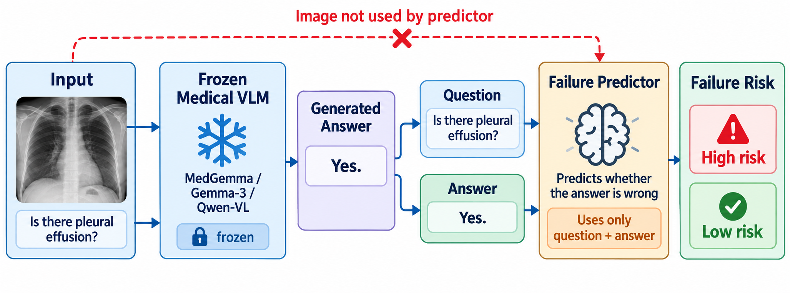
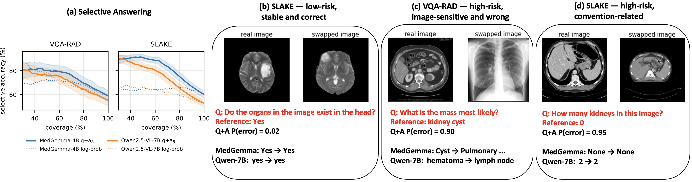

# When will a VLM fail on medical VQA? Image-free risk prediction and shared error structure

Code, prompts, pre-registration, result tables and all model generations for the paper

> **When will a VLM fail on medical VQA? Image-free risk prediction and shared error structure**
> Marouane Tliba, Mohamed Amine Kerkouri, Youssra Taifour, Benyahyia Mohamed Oussama, Emadeldeen Hamdan, Omid Halimi Milani, Zakaria Selam, Nour Abouread, Aladine Chetouani, Ahmet Enis Cetin, Azeddine Beghdadi
> Université Sorbonne Paris Nord · F-Initiatives · University of Illinois Chicago · University of Dubai
> Submitted to ICASSP 2027. [Paper (PDF)](paper/paper.pdf) · [Project page](https://mtliba.github.io/VLM-ImFreeRisk/)

<p align="center"></p>

## TL;DR

After a frozen medical VLM has answered an ordinary, intact image–question pair, **whether that answer is wrong can be predicted without looking at the image**. A logistic regression on frozen BiomedCLIP embeddings of the *question* and of the *generated answer* reaches AUROC **0.77–0.79 on VQA-RAD** and **0.88–0.94 on SLAKE** for five frozen VLMs (MedGemma-4B-IT, Gemma-3-4B-IT, Qwen2.5-VL-7B/3B, Qwen2-VL-2B). Frozen image embeddings alone are near chance (0.49–0.58) and add nothing to the question–answer predictor; token log-probability and sampling self-consistency are generally weaker; a linear probe on the VLM's hidden state is only slightly stronger (0.81–0.85 / 0.93–0.96).

The failures are **shared**: about one quarter of the test items are failed by all five VLMs (3 % expected under independence), and a predictor trained on one VLM's errors detects another's at AUROC 0.71–0.83. Counterfactual image replacement and signal degradation show that the models **do** use the image: predictable failure is not image blindness, and high-risk answers are *more* image-sensitive, not less. The same risk score does not make cheap test-time correction (re-prompting, enhancement, zoom, gating, consensus, self-verification) safe — a 4.5–10.4-point per-item oracle headroom is not recovered — but it supports **selective answering**: keeping the 50 % lowest-risk answers raises exact accuracy from 59/55/60/53 % to 81/76/91/84 % (VQA-RAD/MedGemma, VQA-RAD/Qwen, SLAKE/MedGemma, SLAKE/Qwen).

<p align="center"></p>

## What is in this repository

| Path | Content |
|---|---|
| `scripts/` | Every script used in the paper (generation, counterfactuals, degradation, feature extraction, predictors, interventions, analyses, tables and figures). |
| `prompts/` | The exact prompt templates: `baseline.txt` (used for every main result), `reprompt.txt`, `zoom.txt`, the three anchored-verification prompts, and the two alternative templates used in the robustness control. |
| `evaluation/canonicalization_rules.yaml` | The 22-rule canonicalisation behind Metric B (synonyms, number words, plurals, yes/no equivalents). |
| `evaluation/preregistration_errors.md` | The pre-registered hypotheses (written before the generations were run) and their decision rule. |
| `data/*/{train,validation,test}.jsonl` | The exact splits (sample ids, questions, references, question types, relative image paths). Images are not redistributed; see [data/README.md](data/README.md). |
| `results/` | Every CSV behind the tables (`MANIFEST.md` maps each table to its source file). |
| `paper/` | The submitted PDF and its two figures. |
| `jobs/` | Slurm job scripts used on a single A100-80GB node. |
| `docs/` | Project page. |

**All raw generations** (initial answers, interventions, sampled answers, counterfactual and degradation answers; ~150 MB uncompressed) are attached to the [v1.0 release](https://github.com/mtliba/VLM-ImFreeRisk/releases) as `generations.tar.gz`; unpack it into `results/` to re-run every analysis without a GPU.

## Setup

```bash
git clone https://github.com/mtliba/VLM-ImFreeRisk.git && cd VLM-ImFreeRisk
python -m venv .venv && source .venv/bin/activate
pip install -r requirements.txt          # torch 2.6 (cu124), transformers 5.17, open_clip, scikit-learn, ...
```

Models are loaded from the Hugging Face Hub (`scripts/common.py: MODEL_IDS`); MedGemma and Gemma 3 require accepting their licences and a logged-in `huggingface-cli`.

## Data

```bash
python scripts/download_data.py          # VQA-RAD + SLAKE (English) -> data/{vqa_rad,slake}/images and the jsonl splits
python scripts/prepare_benchmarks.py     # PathVQA, PMC-VQA, OmniMedVQA subsamples (generalisation experiment)
```

The split files shipped in `data/` are the ones used in the paper; `download_data.py` recreates them identically (VQA-RAD validation = 15 % of official-train images held out by image, seed 0; SLAKE = official splits; images are disjoint across splits). See [data/README.md](data/README.md) for licences and sources.

## Reproducing the paper

Stage 1 — generations (GPU). One A100-80GB, ~1 h per VLM and benchmark for the main protocol.

```bash
M=medgemma   # medgemma | gemma3 | qwen (Qwen2.5-VL-7B) | qwen3b | qwen2vl2b
for D in vqa_rad slake; do
  python scripts/run_vlm.py            --model $M --dataset $D --splits test validation train --actions keep          # initial answers
  python scripts/run_vlm.py            --model $M --dataset $D --splits test --actions reprompt enhance zoom           # interventions
  python scripts/run_sampling.py       --model $M --dataset $D --splits test --k 5                                     # self-consistency
  python scripts/run_counterfactual.py --model $M --dataset $D --splits test                                           # no image / blank / swapped
  python scripts/run_degradation.py    --model $M --dataset $D --splits test                                           # blur / downsampling / noise
  python scripts/extract_hidden.py     --model $M --dataset $D                                                         # last-layer hidden state
done
python scripts/extract_biomedclip.py                                                                                   # BiomedCLIP question / answer / image embeddings
python scripts/run_verify.py --model $M --dataset $D --splits validation                                               # anchored self-verification
```
`jobs/*.sh` are the Slurm wrappers that were actually used. Every runner is resumable (already-written sample ids are skipped).

Stage 2 — analyses (CPU, minutes). With `generations.tar.gz` unpacked and the BiomedCLIP features extracted:

```bash
python scripts/error_predictability.py        # Table 1 AUROC block: Q+A, image, image+Q+A, log-prob, sampling, perturbation (CV + train+val->test)
python scripts/error_analysis_extra.py        # template-held-out control, risk-coverage, error clusters, cross-VLM transfer
python scripts/repeated_question_control.py   # SLAKE template-held-out CV
python scripts/stageA_analysis.py             # Table 2: counterfactuals, hidden-state probe, item-vs-model variance
python scripts/stageB_analysis.py             # generalisation to PathVQA / PMC-VQA / OmniMedVQA, cross-VLM overlap and transfer
python scripts/degradation_analysis.py        # blur / downsampling / noise sweep
python scripts/oracle_analysis.py             # per-item oracle and fixed interventions
python scripts/train_selector.py && python scripts/evaluate_selector.py && python scripts/train_gated.py && python scripts/evaluate_revised.py   # gating / routing
python scripts/consensus_stage1.py && python scripts/evaluate_verification.py                                                                     # consensus, anchored verification (Table 3)
python scripts/selective_qaB_test.py          # selective answering: Sel.@50 column of Tables 1 and 3, risk-coverage figure
python scripts/paper_combined_table.py        # regenerates Table 1 from the CSVs
```

### Table → file map

| Paper | Source |
|---|---|
| Table 1 (failure prediction, Sel.@50) | `results/stageB_matrix.csv`, `results/error_predictability.csv`, `results/paper_auroc_bootstrap.csv`, `results/stageA_probe.csv`, `results/selective_qaB_test.csv` |
| Table 2 (counterfactuals, overlap) | `results/stageA_counterfactual.csv`, `results/stageB_overlap.csv`, `results/degradation_summary.csv` |
| Table 3 (correction vs. abstention) | `results/oracle_analysis.csv`, `results/revised_selector_results.csv`, `results/consensus_stage1.csv`, `results/verification_validation_verifiers.csv`, `results/selective_qaB_test.csv` |
| Template-held-out control | `results/repeated_question_control.csv` |
| Error clusters, cross-VLM transfer | `results/error_extra_clusters.csv`, `results/stageB_transfer.csv` |
| Generalisation (PathVQA, PMC-VQA, OmniMedVQA) | `results/stageB_matrix.csv` (rows for the three benchmarks) |
| Fig. 2(a) | `results/selective_qaB_test.csv` (`scripts/selective_qaB_test.py`) |

`results/MANIFEST.md` lists every file with its producing script and the definitions of *score*, *accuracy*, Q+A and the evaluation regimes.

## Definitions used throughout

* **Metric A** — exact match of the first token for yes/no references, token-F1 otherwise (after lower-casing, punctuation and article removal). An answer is *wrong* iff its Metric-A score is < 1. **Metric B** applies `evaluation/canonicalization_rules.yaml` first.
* **Q+A** — logistic regression (C = 0.1) on frozen BiomedCLIP embeddings of the question and of the VLM's generated answer. Main results: fitted on train + validation, evaluated on the official test split; cross-validation results use image-grouped 5-fold CV.
* **Selective answering (Sel.@50)** — exact accuracy of the 50 % of test items with the lowest predicted failure probability.

## Citation

```bibtex
@inproceedings{tliba2027vlmfail,
  title     = {When will a {VLM} fail on medical {VQA}? Image-free risk prediction and shared error structure},
  author    = {Tliba, Marouane and Kerkouri, Mohamed Amine and Taifour, Youssra and Benyahyia, Mohamed Oussama and Hamdan, Emadeldeen and Halimi Milani, Omid and Selam, Zakaria and Abouread, Nour and Chetouani, Aladine and Cetin, Ahmet Enis and Beghdadi, Azeddine},
  booktitle = {IEEE International Conference on Acoustics, Speech and Signal Processing (ICASSP)},
  year      = {2027},
  note      = {under review}
}
```

## Licence

Code and result tables: MIT (see `LICENSE`). The benchmarks and model weights keep their original licences.
